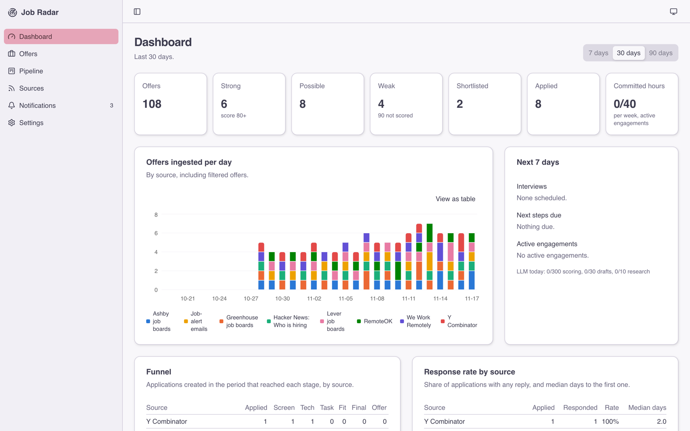
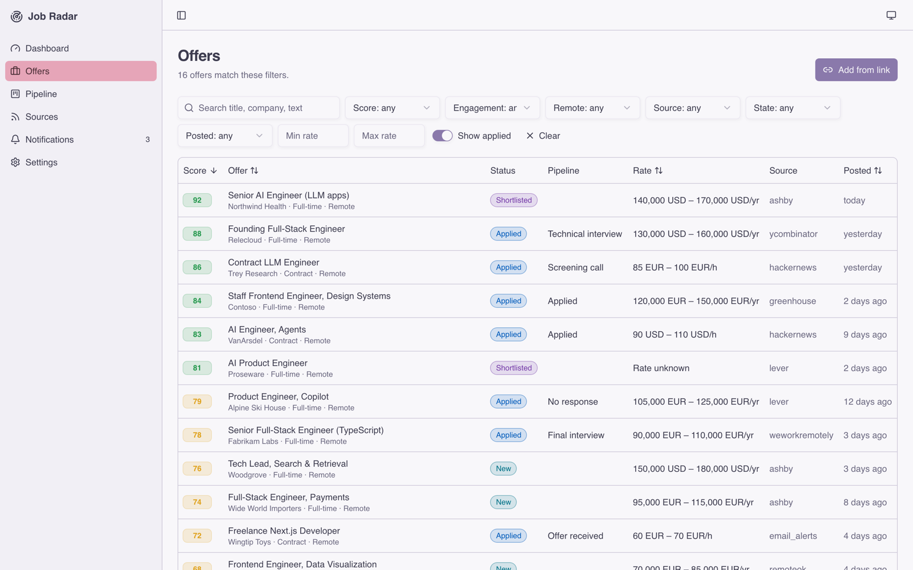
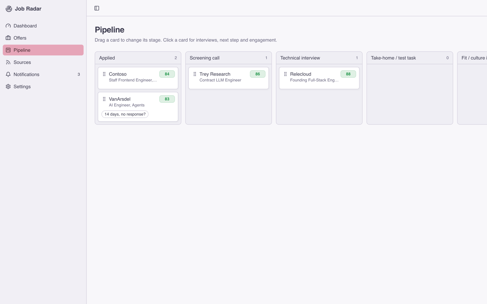

# Job Radar

**A private job-search agent that runs on your own computer.** It watches job boards and freelance
sites, scores every offer against your CV with your Claude subscription, researches the companies,
drafts applications for you to send by hand, alerts you on Telegram and tracks your interview
pipeline.



- **Local only.** Everything runs on your machine: a SQLite database, servers bound to
  `127.0.0.1`, no account, no cloud, no telemetry.
- **It never applies for you.** Job Radar reads and drafts. You review and send every application
  yourself. A guard blocks any click on apply, submit, send, connect or message.
- **No API key.** LLM calls go through your own Claude Code login, with daily caps so it stays
  inside your plan.

> Requires a Claude subscription (Pro or Max) and the
> [Claude Code CLI](https://docs.claude.com/en/docs/claude-code/setup). Job Radar is an
> independent open-source project, not affiliated with Anthropic or any job site.

## What it does

|                          |                                                                                                                                                                                                                                                                                                                                                                                                               |
| ------------------------ | ------------------------------------------------------------------------------------------------------------------------------------------------------------------------------------------------------------------------------------------------------------------------------------------------------------------------------------------------------------------------------------------------------------- |
| **Collects offers**      | Public sources out of the box: Greenhouse, Lever and Ashby boards of the companies you pick, Y Combinator, Hacker News "Who is hiring", RemoteOK, We Work Remotely and Darwin Recruitment (a STEM recruiter's public job feed). Optional: job-alert emails (LinkedIn, Upwork, Malt, Wellfound) read-only over IMAP, SimpleApply match exports (CSV), and logged-in sites through an isolated browser profile. |
| **Scores them**          | A keyword pre-filter, then Claude scores each offer against your CV and preferences (role, seniority, stack, rate, location, contract) with a short explanation and red flags.                                                                                                                                                                                                                                |
| **Researches companies** | Funding, headcount, tech stack, news and red flags, every fact linked to the page it came from.                                                                                                                                                                                                                                                                                                               |
| **Drafts applications**  | Cover messages and proposals grounded only in facts from your CV, with a suggested rate. You copy, edit and send.                                                                                                                                                                                                                                                                                             |
| **Learns from you**      | When you dismiss an offer you say why. Job Radar turns those reasons into plain-language preferences that you can see and edit, and similar offers score lower.                                                                                                                                                                                                                                               |
| **Tracks the pipeline**  | A board from Applied to Offer, with interview prep, follow-up reminders and "what gets responses" stats. Replies in your mailboxes (rejections, interview invitations, take-homes, offers) update it on their own, with Undo.                                                                                                                                                                                 |
| **Notifies you**         | Telegram alerts for strong matches, replies with next steps, offers and rejections (with Undo), quiet hours and a daily digest.                                                                                                                                                                                                                                                                               |



## Install

Choose **one** way to run it. Both keep their data on your machine.

### Option A: macOS app (Apple Silicon)

1. Download `Job-Radar-<version>-arm64.dmg` from the
   [latest release](https://github.com/Manumac86/job-radar/releases/latest) and drag
   **Job Radar** to Applications.
2. The app is **not signed** with an Apple Developer ID, so macOS blocks the first launch. Open it
   once with right-click → **Open** → **Open**. If macOS still refuses, go to **System Settings →
   Privacy & Security → Open Anyway**, or run:
   ```bash
   xattr -dr com.apple.quarantine "/Applications/Job Radar.app"
   ```
3. Install the Claude Code CLI and log in once: `claude`. The app finds it in `~/.local/bin`,
   Homebrew or your shell's PATH. You can also set its path in **Settings → General → Desktop**.
4. On first launch choose **Start fresh**. Choose **Import** only if you already ran Job Radar
   from a folder.

The app starts its own worker and web server (no Docker, no Node.js needed), lives in the menu
bar and keeps running when you close the window. It never updates itself. To update, download
the new release. Its data is in `~/Library/Application Support/Job Radar`.

### Option B: Docker (macOS, Linux, Windows with WSL)

No clone needed. The images are published for amd64 and arm64.

```bash
mkdir job-radar && cd job-radar
curl -LO https://github.com/Manumac86/job-radar/releases/latest/download/docker-compose.release.yml
mkdir -p data secrets && chmod 700 secrets
claude setup-token                   # prints a long-lived token for your subscription
pbpaste > secrets/claude_oauth_token # or paste it into that file by hand
echo "TZ=Europe/Lisbon" > .env       # your time zone (dates, quiet hours, daily caps)
docker compose -f docker-compose.release.yml up -d
open http://127.0.0.1:3000           # use 127.0.0.1, not localhost
```

Ports can be changed in `.env` (`WEB_PORT`, `WORKER_PORT`, `VIEWER_PORT`). To update, run
`docker compose -f docker-compose.release.yml pull && docker compose -f docker-compose.release.yml up -d`.

### Option C: from source

You need Node 22.12+, pnpm 12 and Docker or Claude Code.

```bash
git clone https://github.com/Manumac86/job-radar.git && cd job-radar
pnpm install
docker compose up -d --build   # or `pnpm dev` to run natively (web 3000, worker 4000)
```

## First setup

1. **Your profile.** Job Radar starts with a fictional example profile (Alex Rivera), and says so
   on the dashboard until you replace it. In **Settings → Profile files**, paste your CV in
   Markdown. In **Settings → Preferences**, set target roles, skills, minimum rates, capacity,
   keywords, regions and time zone, either in the form or in the raw `preferences.yaml` (switch
   with **Form | YAML**). Saving from the form changes only the fields you edited and keeps your
   comments. Every change is validated, so an invalid file is never saved.

   **CV variants (optional).** If you keep several versions of your CV (say AI engineer and tech
   lead), add them under **Settings → Profile files → CV variants**. Scoring still judges your
   fit against the full CV, so variants never change a score. The same scoring call also
   recommends which variant to send for each offer, and lists what the offer asks for that this
   variant does not show. Drafts lead with the chosen variant, but every fact still comes from the
   full CV. **Mark as applied** records which CV you sent, and the dashboard compares response
   rates by CV. After you change your variants, **Refresh CV recommendations** rescores your
   shortlisted offers within the daily cap.

2. **Companies.** `companies.yaml` lists companies polled on their public Greenhouse, Lever and
   Ashby boards. The example list is a set of AI and developer-tool companies; make it yours.
3. **Sources.** Open **Sources**, enable a few, and click **Run now**. New offers are
   pre-filtered and scored. Strong matches (80+) get a draft and an alert.
4. **Telegram (optional).** Create a bot with @BotFather. Save its token to
   `secrets/telegram_bot_token` and your chat id to `secrets/telegram_chat_id`.
5. **Job-alert emails (optional, recommended for LinkedIn and Upwork).** Create a Gmail label
   (for example `job-alerts`) and a filter that applies it to alerts from LinkedIn, Upwork, Malt
   and Wellfound. Save an app password to `secrets/imap_app_password`, then set the mailbox and
   label in **Settings → Sources**. The mailbox is opened read-only: nothing is marked as read,
   moved or deleted.

In the macOS app, the secrets folder is `~/Library/Application Support/Job Radar/secrets`. With
Docker, it is `secrets/` next to the compose file.

| Secret file          | How to get it                                               | Needed for       |
| -------------------- | ----------------------------------------------------------- | ---------------- |
| `claude_oauth_token` | `claude setup-token`                                        | Docker only      |
| `telegram_bot_token` | @BotFather on Telegram                                      | Telegram alerts  |
| `telegram_chat_id`   | Message your bot, then read `chat.id` from its `getUpdates` | Telegram alerts  |
| `imap_app_password`  | Google Account → Security → App passwords                   | Job-alert emails |

### Claude usage

Programmatic use counts against your plan's allowance. That is why offers go through a keyword
pre-filter first, scoring uses Haiku, and there are daily caps (default 300 scoring calls, 30
drafts and 10 company researches; change them in **Settings → Preferences**). Caps reset at midnight
in your time zone: the Mac's zone in the app, and `TZ` with Docker (`JOB_RADAR_TIMEZONE`
overrides both).

## Using it



- **Offers.** Filter by score, source and status, open an offer to read the score breakdown, the
  company card and the draft. **Shortlist**, **Dismiss** (with a reason) or **Mark as applied**.
  To track an offer you applied to elsewhere, use **Import → From a link**. If you use
  [SimpleApply](https://simpleapply.ai), click **Export CSV** there and use **Import → SimpleApply
  CSV**: its matches are de-duplicated, filtered and scored like any other offer, and the ones it
  applied to appear in the pipeline. The file is read locally.
- **Pipeline.** Drag applications through the stages. Moving one to an interview stage creates
  an interview prep plan: likely questions, strengths from your CV, gaps and questions to ask.
  Applications with no news get a follow-up reminder after the days you set (default 7).
- **Learning.** After 5 dismissals, or with **Settings → Learning → Learn now**, Claude turns
  your reasons into a few sentences such as "Avoid crypto and web3 companies". You can edit,
  disable or delete each one, or add your own. Shortlists and applications count as
  counterexamples. When you dismiss offers as "salary too low" that actually paid more than your
  minimum, Settings suggests raising it. Nothing changes until you accept.
- **Company research.** This runs when you click **Research company**, when you shortlist an
  offer, and for strong offers (you can turn that last one off). The research agent can only run
  web searches and read public pages through Job Radar's own reader: GET only, no cookies,
  private addresses refused. A fact without a page that was actually read is discarded. Profiles
  are reused for 30 days.

### Email replies (optional)

Job Radar can read the replies to your applications and keep the pipeline current.

1. Go to **Settings → Email** and add each mailbox you use: Gmail, iCloud (including a custom
   domain hosted on iCloud) or any IMAP server. Each one needs an **app password**:
   - Gmail: [myaccount.google.com/apppasswords](https://myaccount.google.com/apppasswords)
     (2-step verification must be on).
   - iCloud: account.apple.com → Sign-In and Security → App-Specific Passwords.
   - Microsoft accounts that only allow OAuth sign-in are not supported.

   The password goes to `secrets/mail/` and is never shown again. Press **Test** to check it.

2. Every 15 minutes (set in **Preferences → Notifications**), or with **Check now**, each
   mailbox is opened **read-only**. Nothing is marked as read, moved, deleted or answered.
3. **What leaves your Mac.** Only emails whose sender is the company you applied to, or a hiring
   platform (Greenhouse, Lever, Ashby, LinkedIn…) that names it, are sent to Claude. Each one
   goes as untrusted data with your open applications at that company. Everything else stays on
   your Mac, and only sender, subject, date, a one-line summary and a short excerpt are kept.
4. **What changes.**
   - When the reply is clear, the application moves forward (screening call, technical,
     take-home, final interview, offer received) or to Rejected. The next step and the interview
     time are filled in.
   - An email never accepts, declines or withdraws, never moves an application backwards and
     never reopens a closed one.
   - Anything unclear becomes a suggestion in **Pipeline → From email**, for you to apply or
     dismiss.
   - Every automatic change has **Undo**, in the app and on the Telegram alert, and each email has
     **Open in Mail**.

Classifying a reply counts against the daily scoring cap.

### Logged-in sites (optional, opt-in)

Malt, Wellfound, Mercor, Upwork, LinkedIn and SimpleApply can be read with your own account. They are off by
default, and enabling one shows a risk notice.

1. Go to **Settings → Sessions → Log in**.
   - In the Mac app, your Google Chrome opens with a separate, isolated profile, so "Sign in with
     Google" works. Without Chrome, the app offers to download Chromium (about 150 MB).
   - With Docker, open the login viewer at `http://127.0.0.1:6080` (it only listens during a
     login).
2. Log in yourself, then click **Done**. Job Radar keeps the browser profile, never a password.

**Risks:** Upwork and LinkedIn restrict automated access and may limit your account even for
read-only browsing. Job Radar reads at most 20 pages per site per hour, with 5–20 s pauses. For
those two sites, the job-alert email source carries no risk and is the recommended path. SimpleApply
only has its match list read (never Simple Apply, Mark as Applied, Not Interested or Full Auto
Apply); its CSV import carries no risk at all.

### Backups

A daily backup goes to `data/backups/`, and the last 14 are kept. To restore one from source,
stop the app and run `pnpm db:restore data/backups/radar-YYYYMMDD-HHMMSS.sqlite`.

## Privacy and safety

- Every port binds to `127.0.0.1`: web, worker API and login viewer. The Mac app's window loads
  only those pages and opens every other link in your browser.
- No telemetry, analytics, crash reporting or auto-update. Claude Code's telemetry and
  non-essential traffic are turned off.
- No API key: API-key variables are removed from the Claude CLI's environment.
- Claude runs with every tool disabled, except the company research agent described above.
- Offer text, emails and web pages are treated as untrusted data in every prompt. The agent never
  follows instructions found in them.
- Secrets stay in `secrets/` (permissions `0700`/`0600`) and are masked in logs. Job Radar never
  stores site passwords.

## Development

```bash
pnpm install
pnpm verify      # typecheck, lint, format, unit tests, UI tests (Playwright), check:local
pnpm dev         # web on 127.0.0.1:3000, worker on 127.0.0.1:4000
pnpm llm:smoke   # one tiny structured call through the Claude Code CLI
pnpm source:dry-run ycombinator   # fetch a source live and print counts, writing nothing
pnpm desktop:build                # the macOS app → apps/desktop/build/release/
```

The UI tests need Playwright's Chromium once:
`pnpm --filter @job-radar/web exec playwright install chromium`.

```
apps/web          Next.js 16 UI (dashboard, offers, pipeline, sources, notifications, settings)
apps/worker       Express API, scheduler, scoring, drafts, research, Telegram, browser sessions
apps/desktop      Electron shell for the macOS app (supervisor, menu bar, first-run import)
packages/db       Drizzle schema, migrations, queries, backups
packages/core     Profile, LLM client, scoring and drafting, rules, time zone
packages/sources  Source adapters, polite fetcher, read-only browser guard
profile-seed/     The example profile a new installation starts with
openspec/         Specs (source of truth) and the history of every change
```

Stack: TypeScript, pnpm and Turborepo, Next.js 16, React 19, Tailwind v4, shadcn/ui, Vercel AI SDK
v7 with `ai-sdk-provider-claude-code`, Express, Drizzle and SQLite, Playwright, Electron and
Docker Compose.

The project is spec-driven with [OpenSpec](https://github.com/Fission-AI/OpenSpec): each feature
is proposed in `openspec/changes/`, implemented task by task with tests, and archived into
`openspec/specs/`. How releases are made is described in [docs/publishing.md](docs/publishing.md).

## License

[MIT](LICENSE).
